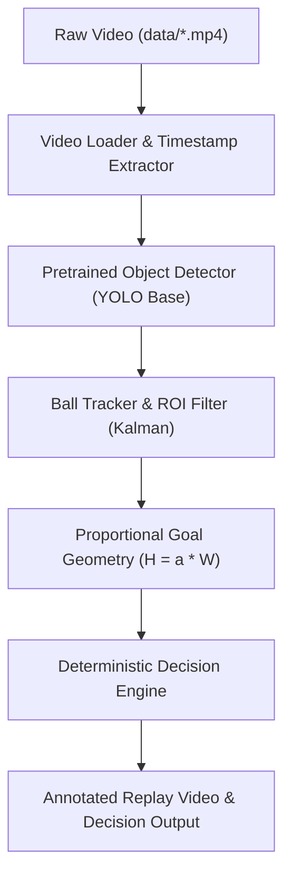

# Virtual Goal Detection — Prototype Implementation Plan (Kaaif)

## 1. Scope & Core Objectives
All development for this proof-of-concept (PoC) is contained within the `prototype/kaaif/` directory. The primary objective is to build an end-to-end, functional Python pipeline that ingests raw goal-view footage from `data/`, detects and tracks the football using off-the-shelf base models (no fine-tuning in this phase), computes crossing geometry against a proportional virtual goal, decides **GOAL / NO GOAL / UNCERTAIN**, and exports an annotated replay video clip.

---

## 2. Key Rules & Geometric Conventions

### A. Proportional Virtual Crossbar Rule
* **Formula:** $\text{Goal Height} = a \times \text{Goal Width}$
* **Default Ratio:** $a = 0.75$ (configurable parameter).
* **Application:** If the physical distance (or baseline pixel distance between marker centers) is $W$, the upper boundary crossbar line is defined at height $H = a \cdot W$ vertically above the ground marker baseline.

### B. Full Ball Penetration Rule
* A goal is **only** awarded if the **entire ball** penetrates the virtual goal plane.
* Representing the ball as a sphere/circle with center $P_{center} = (u, v)$ and radius $r$:
  * **Lateral check:** $u_{center} - r > u_{left\_marker}$ AND $u_{center} + r < u_{right\_marker}$.
  * **Vertical check:** $v_{center} - r > v_{crossbar}$ (in image coordinates where $v$ increases downward, meaning below the crossbar) AND $v_{center} + r \le v_{ground}$.
  * **Crossing plane check:** The entire trailing edge must clear the goal plane transitioning from pitch side to goal side.

### C. Output Classes
* **GOAL:** Explicit visual and geometric evidence of complete crossing inside boundaries.
* **NO GOAL:** Evidence that ball missed wide, passed above crossbar, was stopped/deflected short, or rebounded off marker.
* **UNCERTAIN:** Severe occlusion by goalkeeper/players, tracking loss at critical boundary moment, or ball position within borderline confidence margins.

---

## 3. Directory Structure (`prototype/kaaif/`)

```text
prototype/kaaif/
├── config/
│   └── settings.yaml          # Ratio 'a' (0.75), confidence thresholds, video paths
├── src/
│   ├── __init__.py
│   ├── video_loader.py        # Video ingestion, frame extraction, FPS & timestamp handling
│   ├── detector.py            # Pretrained YOLO inference (class 32: sports ball), ROI filtering
│   ├── tracker.py             # Kalman filter / ByteTrack trajectory smoothing & gap filling
│   ├── goal_geometry.py       # Marker calibration, proportional crossbar (H = a * W), plane logic
│   ├── decision_engine.py     # Deterministic GOAL / NO GOAL / UNCERTAIN state evaluation
│   └── visualizer.py          # Render trajectory trail, virtual goal box, and decision overlays
├── output/                    # Annotated replay videos (.mp4) and frame logs
├── run_pipeline.py            # Main CLI runner to test on video clips in data/
└── requirements.txt           # Python dependencies
```

---

## 4. Phased Implementation Steps



### Phase 1: Environment & Dependency Setup
- Create `prototype/kaaif/requirements.txt` based on essential libraries:
  - `opencv-python`
  - `ultralytics` (for base YOLOv8/v11 models)
  - `numpy`
  - `scipy`
  - `pyyaml`
- Set up `config/settings.yaml` with default parameters:
  - `crossbar_ratio_a: 0.75`
  - `ball_detection_conf: 0.25`
  - `iou_threshold: 0.45`
  - `uncertainty_margin_px: 5`

### Phase 2: Video Ingestion & Base Model Perception
- **`video_loader.py`**:
  - Ingest videos from `../../data/` (`ground (1).mp4` to `ground (15).mp4`).
  - Extract frames with monotonic timestamps (essential for displacement and velocity calculation).
- **`detector.py`**:
  - Load standard pretrained model (e.g., `yolov8n.pt` / `yolov8s.pt` / `yolo11n.pt`).
  - Filter for `sports ball` class.
  - Implement Goal-Side Region of Interest (ROI) clipping to discard distant pitch noise and save inference time.
  - Reject non-ball false positives using aspect-ratio and size thresholding.

### Phase 3: Tracking & Trajectory Continuity
- **`tracker.py`**:
  - Implement a 2D Kalman Filter to track $(u, v, \dot{u}, \dot{v})$.
  - Track association across frames with bounding box / center distance.
  - Maintain an explicit state flag per frame:
    - `OBSERVED`: Visual detection present.
    - `PREDICTED`: Detection missing (e.g., 1–3 frames occlusion/motion blur).
  - Safety check: A transition cannot be ruled a GOAL based purely on `PREDICTED` states.

### Phase 4: Proportional Goal Geometry & Plane Modeling
- **`goal_geometry.py`**:
  - Identify goal markers (manual 2-point input via click/config for setup, or marker coordinates).
  - Calculate marker baseline width $W = \|P_{right} - P_{left}\|_2$.
  - Compute virtual crossbar line:
    $$\text{Height } H = a \cdot W \quad (a = 0.75)$$
  - Construct the 2D/3D projected goal plane bounded by $[P_{left}, P_{right}]$ horizontally and $[0, H]$ vertically.
  - Compute ball radius $r$ from apparent bounding box dimension or reference calibration.

### Phase 5: Deterministic Decision Engine
- **`decision_engine.py`**:
  - Trace the ball's trajectory vector relative to the goal plane line across time.
  - Check entry condition: did the ball transition from front-of-plane to behind-plane?
  - Verify full penetration:
    - Left boundary: $u_{center} - r > u_{left}$
    - Right boundary: $u_{center} + r < u_{right}$
    - Crossbar boundary: $v_{center} - r > v_{crossbar}$ (below crossbar)
  - Evaluate edge cases:
    - If trajectory reverses direction before fully crossing $\rightarrow$ **NO GOAL (Blocked/Rebound)**.
    - If critical crossing frames are missing/occluded $\rightarrow$ **UNCERTAIN**.
    - If trajectory passes over $v_{crossbar} - r$ $\rightarrow$ **NO GOAL (Over)**.

### Phase 6: Visual Replay & Evaluation Runner
- **`visualizer.py`**:
  - Draw virtual goalposts and virtual crossbar onto frames.
  - Overlay ball trajectory trail (color-coded by state: observed vs predicted).
  - Burn decision banner with status and frame count.
- **`run_pipeline.py`**:
  - CLI tool to run any video:
    `python run_pipeline.py --video ../../data/ground\ \(1\).mp4 --ratio 0.75`
  - Output rendered verification clip to `output/`.

---

## 5. Verification & Acceptance Criteria
1. **Pipeline Execution:** Single script runs on clips from `data/` without runtime crashes.
2. **Correct Rule Application:** Accurately calculates height as $0.75 \times W$ and checks the entire ball radius.
3. **No False Positives on High/Wide Shots:** Correctly tags balls clearing above the virtual crossbar as NO GOAL.
4. **Honest Uncertainty:** Correctly yields UNCERTAIN when occlusion occurs during line crossing.
5. **Visual Proof:** Generates clear, annotated replay videos for human verification.
